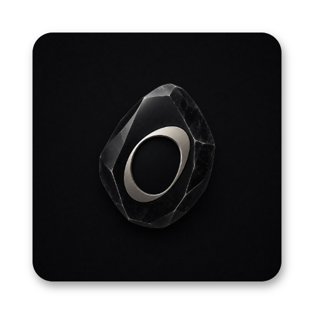
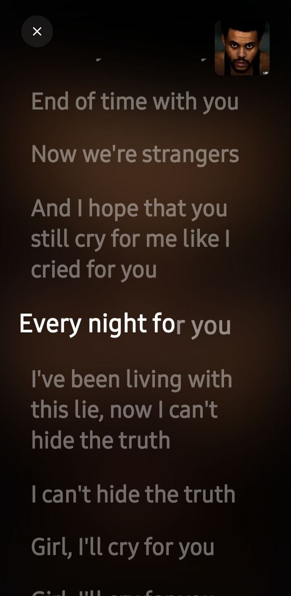
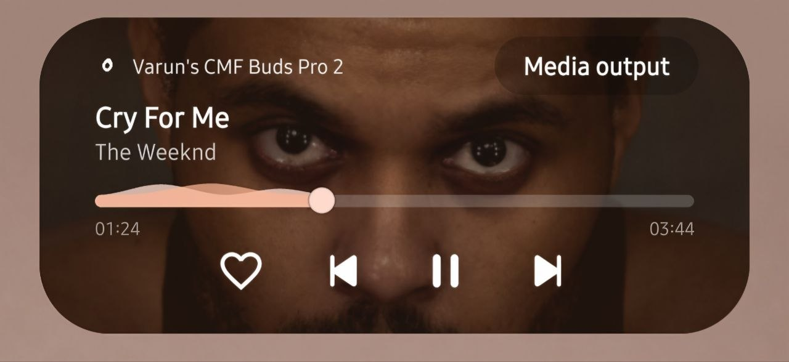

<div align="center">

  

  # XYZ Player 🎵✨

  **Next-Gen Lossless Studio Music Player & YouTube Streamer for Android & Web**

  <p align="center">
    <a href="https://github.com/xyzayush0/XYZ-Player">
      
    </a>
    
    
    
    
  </p>

</div>

---

**XYZ Player** is a studio-grade, feature-packed music player engineered for pure acoustic clarity and visual immersion. Built with high-performance modern web technologies and packaged natively for Android via **Capacitor**, XYZ Player delivers lossless 24-bit studio sound, intelligent YouTube Music streaming, real-time synced lyrics, and an ultra-fluid glassmorphic interface.

---

## ✨ Key Highlights

- 💎 **Studio Lossless Audio Engine:** Native uncompressed 24-bit Hi-Res master and 16-bit CD-quality playback tiers with audio processing and custom equalizers.
- 📺 **YouTube Music Search & Streamer:** Built-in intelligent audio proxy that strips non-music chatter, reactions, podcasts, and video clutter to serve high-bitrate audio streams directly.
- 🎤 **Word-by-Word Synced Lyrics:** Real-time karaoke-style synced lyrics engine with automated line scrolling, active word highlights, and animated interlude timers.
- 📱 **Signature Dynamic Live Pill:** Floating Android 13+ style media pill widget with rotating vinyl artwork, background playback controls, and quick gestures.
- 💾 **Offline Lossless Storage:** Store entire albums and YouTube audio streams locally on your device using high-speed IndexedDB caching.
- 🎨 **Obsidian Glassmorphism UI:** Ultra-modern dark aesthetic featuring reactive ambient glow matching album colors, smooth micro-animations, and full-screen immersive mode.
- 📲 **Universal Platform:** Runs seamlessly as a Native Android APK (Capacitor), Progressive Web App (PWA) with offline service workers, and standalone desktop browser app.

---

## 📸 Screenshots

<div align="center">
  <table>
    <tr>
      <td align="center"><b>Studio Player & EQ</b></td>
      <td align="center"><b>Synced Lyrics Engine</b></td>
      <td align="center"><b>Dynamic Floating Pill</b></td>
    </tr>
    <tr>
      <td align="center"></td>
      <td align="center"></td>
      <td align="center"></td>
    </tr>
  </table>
</div>

---

## 🛠️ Architecture & Tech Stack

- **Core Frontend:** Vanilla HTML5, CSS3 Custom Properties (Design Tokens & Glassmorphism), Modern ES6+ JavaScript.
- **Audio Pipeline:** Web Audio API, IndexedDB offline storage (`offlineDb.js`), MediaSession API background playback.
- **Native Android:** [Capacitor 8](https://capacitorjs.com/) with native Android runtime (`com.xyzplayer.music`).
- **Backend / Streaming:** Python 3 HTTP server (`server.py`) + `@distube/ytdl-core` helper and Vercel serverless audio search API (`api/search.py`).

---

## 🚀 Getting Started

### 1. Web / Desktop Development
Clone the repository and launch the local development server:

```bash
# Clone the repository
git clone https://github.com/xyzayush0/XYZ-Player.git
cd XYZ-Player

# Install dependencies
npm install

# Start development server
npm start
```
Open **`http://localhost:8080`** in any modern web browser.

---

### 2. Android Build (Capacitor)
To build and run the native Android app:

```bash
# Sync web build to Android project
npm run cap:sync

# Open in Android Studio
npm run cap:open
```
In Android Studio, click **Run 'app'** or build an unsigned release APK via `Build > Generate Signed Bundle / APK`.

---

## 📄 License

Distributed under the **Apache License 2.0**. See [`LICENSE`](LICENSE) for complete details.

---

<div align="center">
  <sub>Engineered with ❤️ by <b>Ayush Dey</b> (<a href="https://github.com/xyzayush0">@xyzayush0</a>).</sub>
</div>
